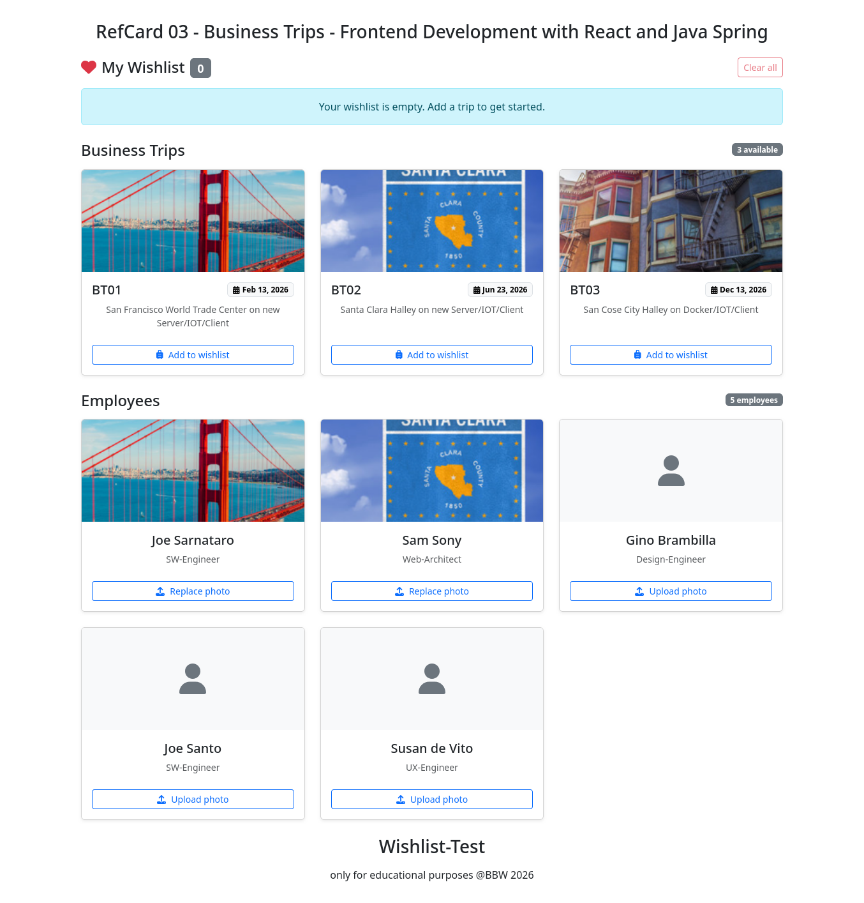
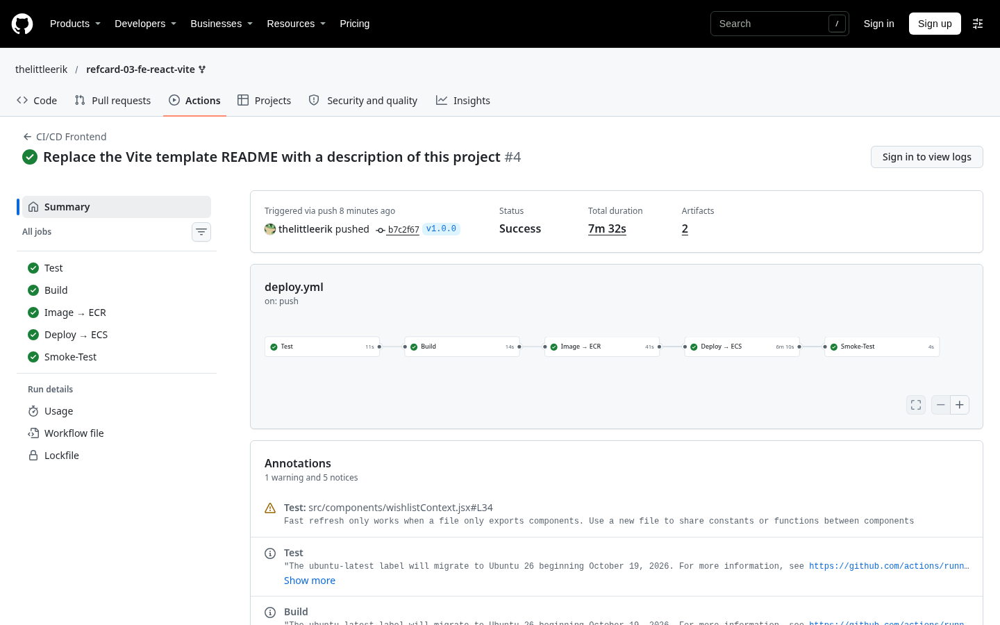
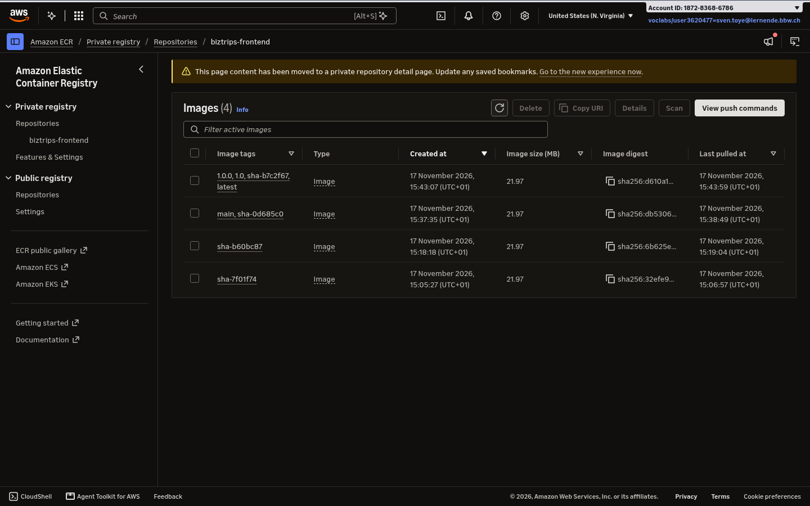
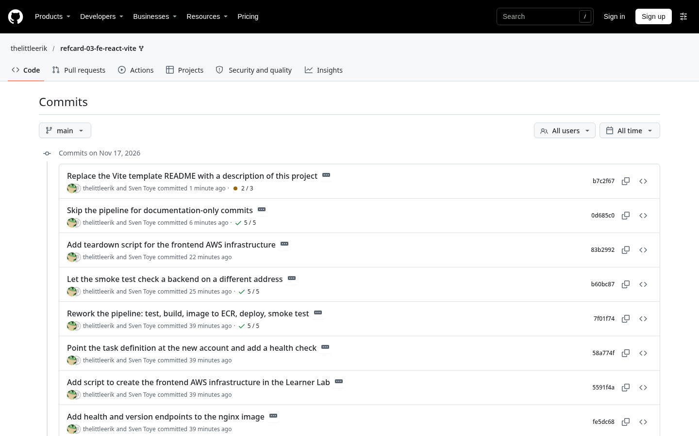

# RefCard 05 – Frontend auf AWS ECS

Abgabe von **Erik Oros** und **Sven Toye** (Partnerarbeit). Dieses Dokument beschreibt den Frontend-Teil.
Architektur, RDS, S3, IAM und der Umgang mit den Learner-Lab-Zugangsdaten stehen in der
[Gesamtdokumentation im Backend-Repo](https://github.com/thelittleerik/RefCard-03-be-SpringBootBusinessTrips/blob/main/docs/RefCard05.md).

Applikation: <http://biztrips-alb-813624757.us-east-1.elb.amazonaws.com> (nur solange die Lab-Session läuft).



Die Trips kommen aus der RDS-Datenbank, die Fotos der Mitarbeitenden aus dem S3-Bucket.

## 1. Was im Frontend neu ist

- **Mitarbeitende mit Foto-Upload** (`src/components/EmployeeList.jsx`): zeigt alle Mitarbeitenden, lädt
  ein Foto hoch oder ersetzt es. Meldet das Backend einen Fehler (z. B. fehlende Rechte auf den Bucket),
  erscheint die Meldung auf der Karte.
- **nginx** ([`nginx.conf`](../nginx.conf)): `/healthz` für Health-Checks, `/version.json` mit der
  ausgelieferten Version. Dateien unter `/assets` werden lange gecacht, `index.html` nie – so zeigt der
  Browser nach einem Deployment sofort den neuen Stand.

## 2. Pipeline

[`.github/workflows/deploy.yml`](../.github/workflows/deploy.yml):

| Job | Was passiert |
| --- | --- |
| **Test** | `npm ci`, ESLint, Vitest (6 Tests). |
| **Build** | Vite-Build, `dist/` als Artefakt. |
| **Image → ECR** | Version bestimmen, Multi-Stage-Image bauen (Node baut, nginx liefert aus), nach ECR pushen. |
| **Deploy → ECS** | Task-Definition mit dem neuen Image registrieren, Rolling Deployment, warten bis stabil. |
| **Smoke-Test** | Den ausgelieferten Stand von aussen prüfen ([`scripts/smoke-test.sh`](../scripts/smoke-test.sh)). |

Pull Requests laufen nur bis **Build**. Reine Dokumentations-Commits lösen keine Pipeline aus.
npm-Abhängigkeiten und Docker-Layer werden gecacht.



## 3. `VITE_API_BASE_URL`

Vite kompiliert die Backend-URL beim Build fest ins JavaScript-Bundle. Sie ist deshalb ein Build-Argument
des Images und keine Umgebungsvariable des Containers.

| Umgebung | Wert | Wo gesetzt |
| --- | --- | --- |
| AWS | `http://biztrips-alb-813624757.us-east-1.elb.amazonaws.com/` | Repository-Variable `VITE_API_BASE_URL` |
| Lokal (`npm run dev`) | `http://localhost:8080/` | [`.env`](../.env) |
| Lokal (Compose) | `http://localhost:8080/` | Build-Argument in `refcard-05-compose` |

Fehlt die Variable oder endet sie nicht mit `/`, bricht der Job **Image → ECR** mit einer Fehlermeldung ab.
Ohne diese Prüfung würde ein Image entstehen, das `http://localhost:8080` anspricht und auf AWS leer bleibt.

Frontend und Backend liegen hinter demselben Load Balancer. Der Browser ruft das Backend also unter
derselben Adresse auf wie die Seite – es braucht kein CORS.

Ändert sich die Adresse des Load Balancers (z. B. nach einem Neuaufbau der Infrastruktur):

```bash
gh variable set VITE_API_BASE_URL --body "http://<neue-alb-adresse>/"
gh workflow run deploy.yml      # Image neu bauen und deployen
```

## 4. Versionierung

Gleiches Schema wie im Backend: Ein Git-Tag `vX.Y.Z` ergibt die Image-Tags `X.Y.Z`, `X.Y` und `latest`;
ein Push auf `main` ergibt `sha-<commit>` und `main`. Details in der
[Gesamtdokumentation](https://github.com/thelittleerik/RefCard-03-be-SpringBootBusinessTrips/blob/main/docs/RefCard05.md#3-versionierung-aufgabe-1).



## 5. ECS-Deployment

| | |
| --- | --- |
| Service | `biztrips-frontend-service` im Cluster `biztrips-cluster` (Fargate) |
| Tasks | 2 |
| CPU / Speicher | 0.25 vCPU / 0.5 GB |
| Health-Checks | Container und Load Balancer: `/healthz` |
| Erreichbar | nur vom Load Balancer (Security Group) |

Neue Tasks starten, bevor alte entfernt werden. Werden neue Tasks nicht gesund, behält ECS die alte Version
(Deployment Circuit Breaker).

Nach jedem Deployment prüft der Smoke-Test über den Load Balancer:

1. `/healthz` antwortet.
2. `/version.json` nennt **den Commit, der gerade deployt wurde** – so fällt ein Rollback auf.
3. Die Startseite enthält die React-App und verweist auf ein JS-Bundle.
4. Das JS-Bundle wird ausgeliefert.

Zusätzlich meldet er als Warnung, wenn das Backend unter derselben Adresse keine Trips liefert.

## 6. Infrastruktur

```bash
./infra/setup-aws.sh       # ECR-Repository, Log-Group, Target Group, Service (mehrfach ausführbar)
./infra/teardown-aws.sh    # wieder löschen, fragt nach der Account-ID
```

Cluster, Load Balancer und Security Groups legt das Backend-Repo an; dessen `infra/setup-aws.sh` muss
zuerst gelaufen sein.

## 7. Zugangsdaten

Drei GitHub Secrets aus der Learner-Lab-Session (`AWS_ACCESS_KEY_ID`, `AWS_SECRET_ACCESS_KEY`,
`AWS_SESSION_TOKEN`), keine Zugangsdaten im Code. Nach einer neuen Lab-Session:

```bash
./scripts/refresh-lab-secrets.sh
```

Der ganze Ablauf und der Vergleich mit OIDC stehen in der
[Gesamtdokumentation](https://github.com/thelittleerik/RefCard-03-be-SpringBootBusinessTrips/blob/main/docs/RefCard05.md#8-learner-lab-zugangsdaten-aufgabe-3).

## 8. Nachweise

- [Commits](https://github.com/thelittleerik/refcard-03-fe-react-vite/commits/main/) – beide Autoren auf jedem Commit
- [Workflow-Läufe](https://github.com/thelittleerik/refcard-03-fe-react-vite/actions)


